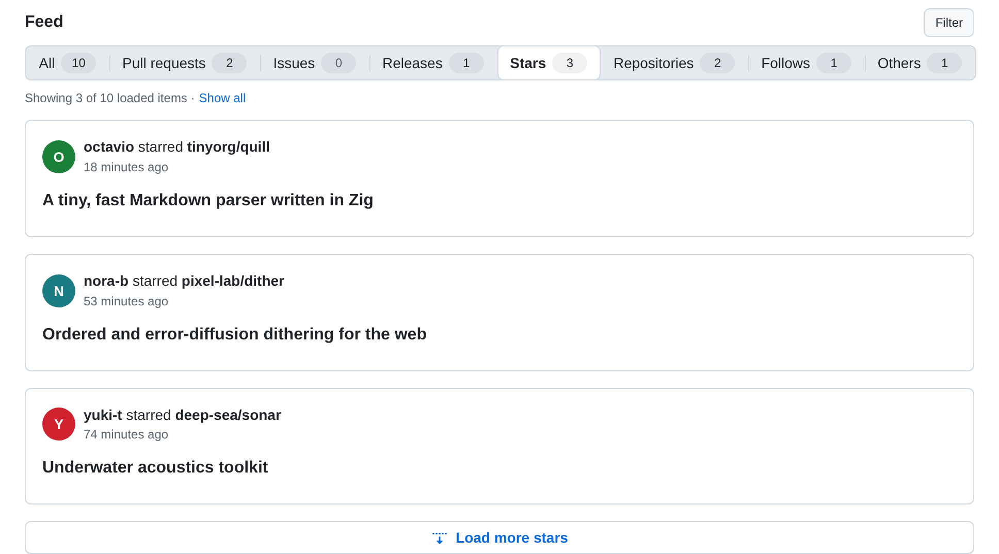
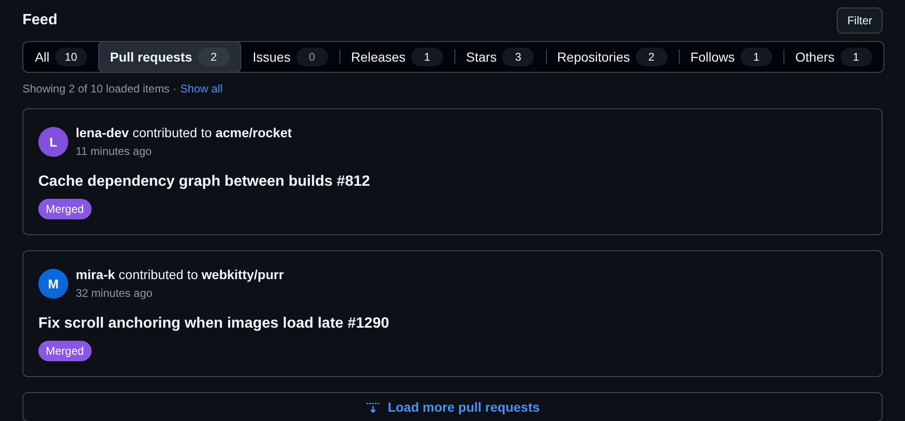
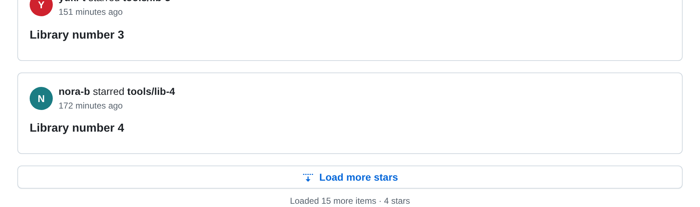

# [Github Timeline](https://github.com/mykiwi/github-timeline)

Filter your GitHub feed in one click: **pull requests, issues, releases, stars, repositories, follows** and the rest.








## Features

- **One-click filters with live counts:** All · Pull requests · Issues · Releases · Stars · Repositories · Follows · Others.
- **Looks like GitHub.** It is built from GitHub's own Primer design tokens, so it follows light, dark, dimmed and high-contrast themes automatically.
- **Remembers your choice** between visits and keeps open tabs in sync.
- **"Load more stars" at the end of the list.** It loads whole pages of your feed, so every kind of activity comes in, and the filter only decides what you see. With a filter on, it keeps loading until about 10 more matching cards appear (at most 5 pages per click), shows progress with a *Stop* link, and tells you what came in: "Loaded 15 more items · 4 stars". With *All*, it loads one page, just like GitHub's *More* button, which it replaces.
- **Keeps filtering as the feed grows.** Cards added by live updates or the native *Filter* menu are filtered too, and an empty state explains when nothing loaded so far matches.
- **Responsive:** labels at full width, icons with counters on narrower columns, icons only on mobile widths.
- **Private and light.** It needs no permissions, makes no network requests and needs no token. It only reads the feed GitHub already rendered.
- Keyboard and screen-reader friendly: real buttons, `aria-current`, visible focus ring, and a live status line ("Showing 3 of 21 loaded items · Show all").

## Install

### Chrome, Edge, Brave, Arc (extension)

1. Download `github-timeline-<version>.zip` from the [latest release](https://github.com/mykiwi/github-timeline/releases/latest) (or run `make build`) and unzip it.
2. Open `chrome://extensions`, turn on **Developer mode**, click **Load unpacked** and pick the unzipped folder.

### Firefox (extension)

Open `about:debugging#/runtime/this-firefox` → **Load Temporary Add-on…** → pick `manifest.json`.
To install it permanently, submit the zip to [addons.mozilla.org](https://addons.mozilla.org/developers/). It passes `web-ext lint` with no warnings.

### Any browser (userscript)

Install [Violentmonkey](https://violentmonkey.github.io/) or [Tampermonkey](https://www.tampermonkey.net/), then open
[`dist/github-timeline.user.js`](https://raw.githubusercontent.com/mykiwi/github-timeline/master/dist/github-timeline.user.js). Your userscript manager offers to install it and keeps it updated.

## How it works

GitHub tags every feed card with metadata, e.g. `data-hydro-view='{"payload":{"feed_card":{"card_type":"MERGED_PULL_REQUEST"}}}'`.
The extension reads the words in `card_type` and sorts each card into a category:

| Filter        | Card types (examples)                                                   |
| ------------- | ----------------------------------------------------------------------- |
| Pull requests | `MERGED_PULL_REQUEST`, `OPENED_PULL_REQUEST`                            |
| Issues        | `OPENED_ISSUE`                                                          |
| Releases      | `RELEASE`                                                               |
| Stars         | `STARRED_REPOSITORY`                                                    |
| Repositories  | `CREATED_REPOSITORY`, `FORKED_REPOSITORY`                               |
| Follows       | `FOLLOWED_USER`                                                         |
| Others        | announcements (`NEW_DISCUSSION`), sponsors, trending, recommendations… |

Matching on keywords, not exact values, means new card variants land in the right place without an update. Cards with no metadata fall back to their header text ("starred", "forked", "released"…).

## Development

```sh
make install       # npm ci + Playwright's Chromium
make build         # dist/github-timeline.user.js + dist/github-timeline-<version>.zip
make test          # build, then run the end-to-end tests
make screenshots   # regenerate screenshots/
make               # list all targets
```

The tests load the real unpacked extension and the built userscript in Chromium against a stand-in for GitHub's feed markup (`test/fixture.mjs`). They cover classification, persistence, pagination, re-mounting after Turbo navigation, themes, responsive layouts and keyboard use. They use Playwright's Chromium by default, because branded Google Chrome 137+ ignores `--load-extension`; override with `make test CHROME=/path/to/chromium`.

CI runs the tests on every push and pull request, and fails if the committed `dist/github-timeline.user.js` is out of date.

### Releasing

```sh
make release VERSION=2.0.1
```

This bumps the version in `manifest.json` and `package.json`, runs the tests, commits, tags `2.0.1` and pushes. The tag triggers CI, which creates the GitHub release with the zip and the userscript attached.

### GitHub Actions

Actions are pinned to verified commits in `.github/workflows/actions.lock` with [gh-actions-lock](https://github.com/github/gh-actions-lock). After changing a `uses:` line, or to pick up new commits on the pinned tags, run `make lock` and commit the lockfile. CI fails if it is out of sync.

```
manifest.json            Manifest V3, same package for Chrome and Firefox
src/github-timeline.js   content script (also the userscript body)
src/github-timeline.css  styles, Primer tokens only
scripts/build.mjs        builds the userscript and the zip (no dependencies)
test/                    fixture + end-to-end tests
.github/workflows/       CI, release, lockfile check
Makefile                 build, test, lock, release
```
